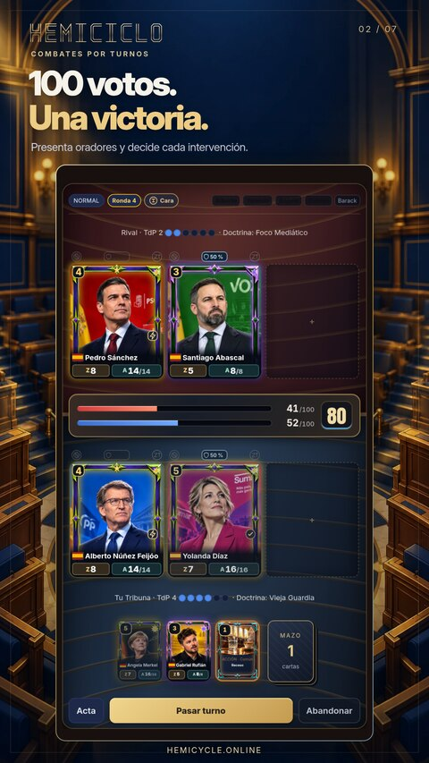
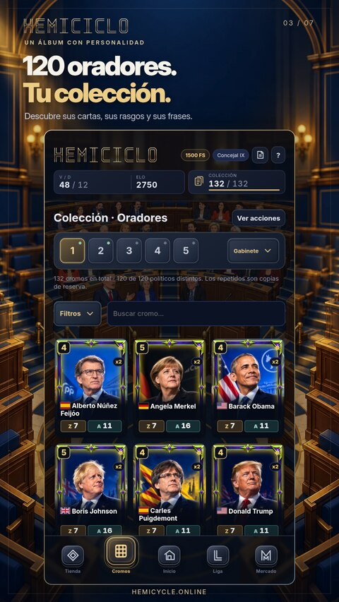
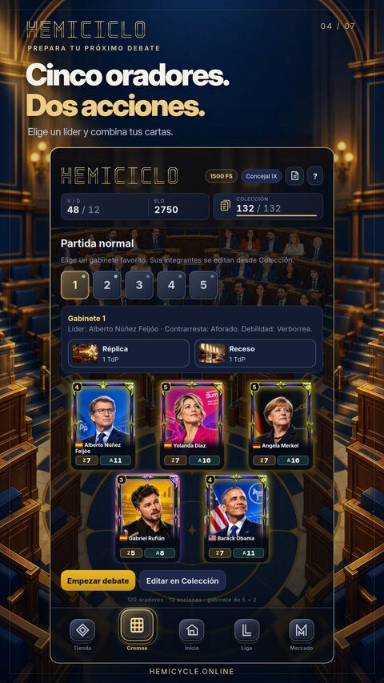
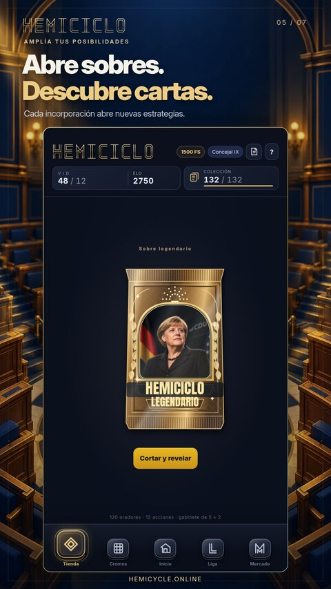
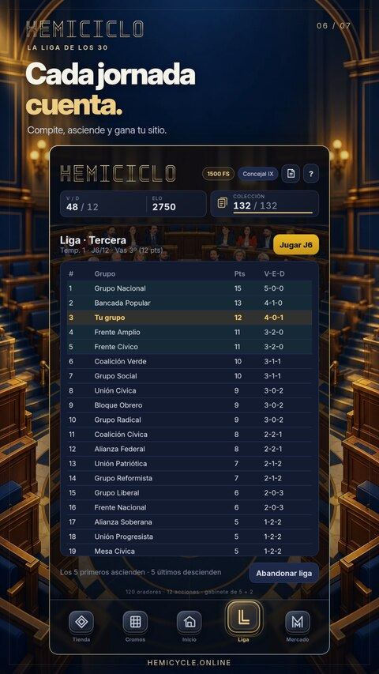
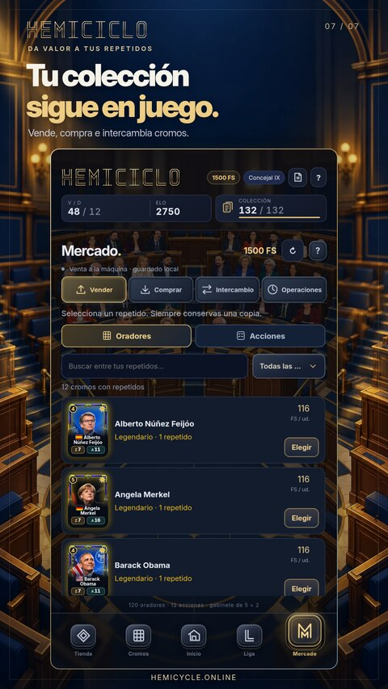

<p align="center">
  
</p>

<p align="center">
  <strong>120 oradores · 12 acciones · Un debate por ganar</strong><br>
  Juego de colección y estrategia por turnos, ambientado en la política.
</p>

<p align="center">
  <a href="https://hemicycle.online/"><strong>▶ JUGAR A HEMICICLO</strong></a>
  &nbsp; · &nbsp; <a href="#primeros-pasos">Primeros pasos</a>
  &nbsp; · &nbsp; <a href="#reglas-esenciales">Reglas</a>
  &nbsp; · &nbsp; <a href="#ayuda-y-contacto">Ayuda</a>
</p>

Forma un gabinete de **cinco oradores**, elige a tu líder y añade hasta **dos cartas de acción**. Presenta tus cromos en la Tribuna, aprovecha sus doctrinas y decide cuándo atacar, defender o recuperar fuerzas. Tu objetivo: **alcanzar 100 votos**.

Hemiciclo está en **prelanzamiento**. Puedes jugar en el navegador de móvil u ordenador y añadirlo a la pantalla de inicio cuando tu navegador lo permita. La interfaz cuenta con ajustes de texto, iconos y sonido, tutoriales y prácticas sin riesgo para tu colección.

<p align="center">
  <a href="press/google-play/es-ES/02-combate.png"></a>
  <a href="press/google-play/es-ES/03-coleccion.png"></a>
  <a href="press/google-play/es-ES/01-inicio.png"></a>
</p>

<details>
<summary><strong>Más imágenes: gabinete, sobres, Liga y Mercado</strong></summary>

<p align="center">
  <a href="press/google-play/es-ES/04-gabinete.png"></a>
  <a href="press/google-play/es-ES/05-sobres.png"></a>
  <a href="press/google-play/es-ES/06-liga.png"></a>
  <a href="press/google-play/es-ES/07-mercado.png"></a>
</p>

Las imágenes muestran la interfaz del juego con una partida de demostración. [Ver el material promocional y descargar las siete capturas](press/README.md).

</details>

## Primeros pasos

1. Abre **[hemicycle.online](https://hemicycle.online/)** y pulsa **Iniciar**. Puedes continuar como invitado o acceder a una cuenta según tu tramo de edad.
2. Completa la práctica inicial de ocho pasos. No concede ni consume premios; las guías completas se pueden repetir desde **Ayuda**.
3. En **Cromos → Gabinete**, prepara cinco oradores distintos y marca al líder. Puedes guardar cinco gabinetes favoritos y equipar hasta dos acciones distintas.
4. Vuelve a **Inicio**, abre la flecha junto a **Jugar** y elige una modalidad. La partida rápida prepara un gabinete automáticamente con tu colección.
5. Usa el **Tiempo de Palabra (TdP)** para presentar cartas. Toca un orador de tu Tribuna para escoger su intervención y pulsa **Pasar turno** cuando termines.
6. Gana llegando a **100 votos**. Al principio de cada turno sumas votos por tu bancada; expulsar a un orador rival también aporta sus escaños.

## Reglas esenciales

| Elemento | Para qué sirve |
| --- | --- |
| **TdP** | Paga la presentación de oradores y las cartas de acción. Se renueva al empezar tu turno. |
| **Zasca (Z)** | Daño de la intervención normal del orador. |
| **Aguante (A)** | Resistencia del cromo. Al agotarse, sale de la Tribuna. |
| **Escaños** | Aportan votos mientras el orador está en mesa. Al expulsar a un rival, sumas los escaños de ese rival. |
| **Líder** | Empieza en tu mano con bonificación y activa su doctrina mientras está en la Tribuna, salvo que sea neutralizada. |

Los escaños base son **2 / 3 / 4 / 5** para comunes, raros, especiales y legendarios. Cada turno añade también **3 votos base**. [Consultar la tabla de estadísticas y el ajuste de esta versión](docs/balance/ajuste-2026-10-29.md).

Tienes **tres huecos de Tribuna**. La mano reserva espacio para dos oradores y una acción disponible; las cartas restantes esperan en el mazo. Cada orador puede intervenir **una vez por turno propio**.

- **Ataque normal:** usa el Zasca actual del cromo. Algunos oradores generan un estado como máximo una vez cada dos turnos propios. Cada cromo admite uno; toca su icono para consultar el efecto y la duración. La ficha de Colección explica su habilidad.
- **Ataque fuerte:** causa el 150 % del Zasca, redondeado hacia arriba, y cuesta un punto de Aguante. Su oportunidad aparece en el tercer turno propio del cromo en mesa y después cada tres turnos; si no la usas, debes esperar al siguiente ciclo.
- **Defensa o curación:** la tercera frase abre ambas opciones. La defensa reduce a la mitad el próximo golpe; la curación recupera la mitad del Aguante perdido, con un mínimo de tres y sin superar su máximo. Tras curarse, ese orador deja pasar un turno propio completo antes de volver a curarse.
- **Cartas de acción:** puedes usar una por turno. No ocupan hueco de orador. Consulta su coste, objetivo, recuperación y posibles límites antes de activarlas.

La doctrina de tu líder puede neutralizar otra. Los iconos de estado permiten consultar sus efectos; **Acta** muestra las jugadas recientes sin ocupar permanentemente la mesa.

> El reloj forma parte de la partida: agotar el turno supone abandonar. Normal y Clasificatoria tienen turnos de 90 segundos; Rápida, de 60. Las prácticas guiadas no ponen en riesgo tu progreso.

## Modos de juego

| Modalidad | Qué propone |
| --- | --- |
| **Normal** | Juega con uno de tus gabinetes y ensaya estrategias. |
| **Rápida** | Gabinete automático con tu colección y turnos de 60 segundos. |
| **Clasificatoria** | Avanza por Elo en seis rangos con diez subdivisiones cada uno. Los ascensos tienen recompensas en el Buzón. |
| **Liga de los 30** | Temporadas de doce jornadas frente a la IA, tres divisiones y ascensos y descensos. El premio de cierre depende de tu puesto: de 300 a 1.100 FS. |

**Jugadores** permite invitar a otras cuentas a Normal o Rápida. Desde el selector de Jugar puedes buscar rival para Clasificatoria online. Estas funciones necesitan conexión y una cuenta habilitada.

En Clasificatoria y Liga hay transferencia de cromos según el resultado, con protección de los cinco últimos oradores únicos. Revisa las reglas de la modalidad antes de entrar.

## Colección y Mercado

**Cromos** reúne los oradores, las acciones y tus gabinetes. Puedes buscar por nombre y desplegar filtros de país, rareza y doctrina. Toca una carta para consultar sus datos y sus frases.

**Tienda** ofrece sobres que amplían la colección. **FS** es una moneda virtual del juego: actualmente no hay compras con dinero real ni canje por dinero. Desafíos, Logros y Buzón reúnen objetivos y recompensas; despliega la flecha de Inicio para ver los accesos adicionales.

En **Mercado** puedes vender repetidos conservando una copia. Las compras e intercambios entre jugadores requieren conexión y cuenta. Revisa cantidad e importe antes de confirmar; las cartas de una oferta publicada pueden quedar reservadas hasta su compra o retirada.

## Guardado y cuenta

- **Invitado:** el progreso se conserva en este navegador y dispositivo. Borrar sus datos puede eliminar esa copia.
- **Cuenta y Nube:** usa siempre tu misma cuenta. Al cambiar de dispositivo, comprueba o recupera su copia antes de continuar. No mezcles partidas de cuentas distintas.
- **Copia de seguridad:** desde Ayuda puedes exportar e importar tu guardado. Conserva una copia antes de cambiar de navegador o de origen.
- **Sin conexión:** prepara los recursos desde **Opciones → Preparar recursos sin conexión**. El invitado dispone del juego local; las partidas descargadas de una cuenta vinculada conservan sus premios pendientes hasta validarlos al reconectar.

Las funciones de cuenta están disponibles desde los **14 años**. Los jugadores de **12–13 años** utilizan el modo invitado. El mínimo de acceso no sustituye la clasificación que pueda asignar una tienda.

<details>
<summary><strong>¿Vienes de la antigua dirección de GitHub Pages?</strong></summary>

El guardado local de GitHub Pages y el de `hemicycle.online` pertenecen a orígenes diferentes: no se trasladan automáticamente. Conserva una copia del guardado antiguo y comprueba la nube de tu cuenta habitual al entrar en el dominio nuevo. Si hay una migración pendiente, revisa su estado desde Nube antes de iniciar partidas con premios vinculados.

</details>

## Ayuda y contacto

| Necesitas… | Dónde encontrarlo |
| --- | --- |
| Aprender o practicar | **Ayuda:** combate guiado, guía de menús, guía de Mercado y retos tácticos. |
| Consultar habilidades y sus oradores | **Ayuda → Habilidades del básico**. La ficha de cada cromo muestra su efecto particular. |
| Mejorar la lectura | **Opciones:** tamaño de texto y de iconos. |
| Ajustar el audio | **Opciones:** volumen maestro, música y efectos. |
| Consultar partidas anteriores | **Inicio → flecha de accesos → Historial**. |
| Revisar una espera online | **Ayuda → Si una conexión tarda → Diagnóstico de conexión**. Mide operaciones completas, no ping, y solo se exporta si lo solicitas. |
| Pedir ayuda | [soporte@hemicycle.online](mailto:soporte@hemicycle.online). |
| Consultar una frase o su adaptación | [Fuentes de los oradores](https://hemicycle.online/fuentes/). |

Para comunicar un fallo, indica la pantalla, los pasos para reproducirlo y el navegador/dispositivo. Una captura o la referencia de error pueden ayudar. **No publiques contraseñas, enlaces de recuperación, claves ni archivos completos de guardado.**

## Para desarrollar o revisar el proyecto

La interfaz se sirve como archivos estáticos. Para abrir una copia local:

```sh
git clone https://github.com/DoomsGarden/Hemicycle.git
cd Hemicycle
python3 -m http.server 8080
```

Abre `http://localhost:8080/`. Esa dirección permite revisar la interfaz y el juego local; las funciones vinculadas necesitan su configuración de autenticación, servicio y orígenes autorizados.

- [Habilidades de básicos y reparto de la primera prueba](docs/balance/efectos-basicos-2026-10-29.md)
- [Servicio online y configuración](_dev/online/README.md)
- [Supervisión y diagnóstico del servicio](_dev/operations/README.md)
- [Material promocional y exportaciones](press/README.md)
- [Notas de la versión v31.0.2.8](_dev/releases/v31.0.2.8.md)

Las pruebas de reglas y servicios están en `tests/`; las de base de datos usan PostgreSQL aislado mediante PGlite. Las comprobaciones visuales requieren Playwright y Chromium. Las herramientas y evidencias de `_dev/` se conservan en Git y están excluidas del sitio publicado.

---

**Hemiciclo es un proyecto independiente y no oficial**, sin afiliación a partidos, instituciones ni personas representadas. Los retratos son ilustraciones de estilo realista generadas mediante IA; las estadísticas y los combates son reglas ficticias. Consulta las [fuentes](https://hemicycle.online/fuentes/) y la [información legal y de contacto](https://hemicycle.online/legal/).
