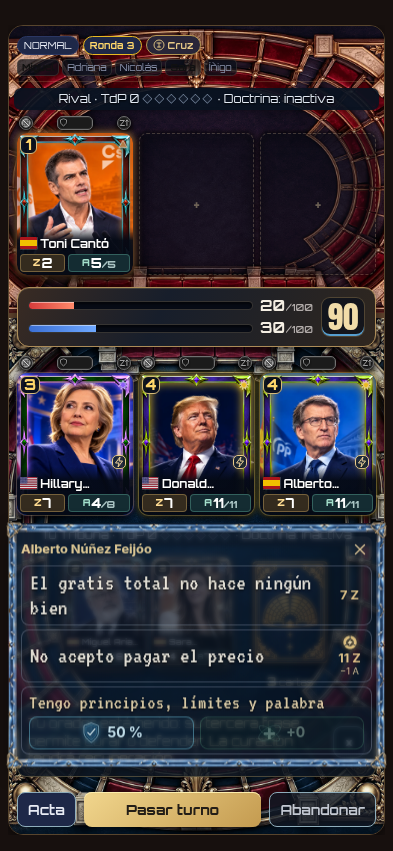
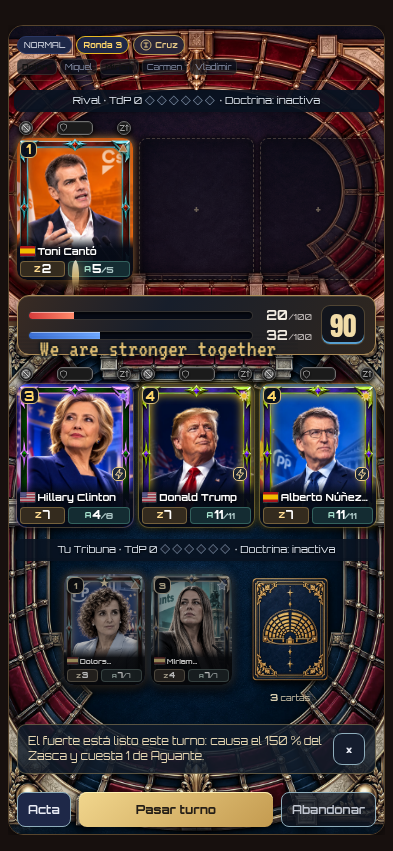
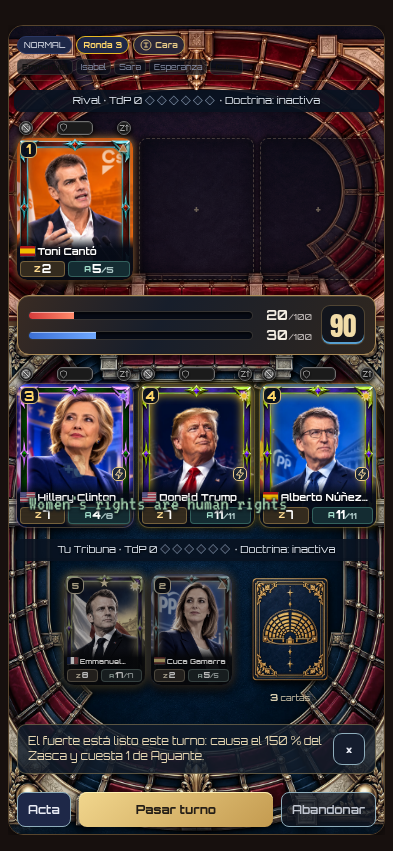

# Selector y secuencias de combate · v31.0.2.12

La posición del selector utiliza el borde inferior de la Tribuna propia, sin buscar huecos encima de las cartas. Las frases conservan su contenido completo y ajustan tamaño y líneas. Los fondos y marcos actuales se mantienen.

La mesa conserva una representación anterior durante la intervención; el estado del motor sigue siendo el real. Las frases de ataque viajan hacia el objetivo, y los apoyos se quedan en la mitad propia. Aguante, impacto y retirada se presentan en orden. Los finales esperan al vaciado de la secuencia, incluyendo respuestas online con varios eventos y cierres de partidas descargadas. No se alteran los motores ni el reloj.

## Comprobaciones

- 48 configuraciones: seis temas de menú × cuatro pantallas (320 × 568, 393 × 851, 768 × 1024 y 844 × 390) × texto al 100 %/116 %, con iconos al 116 %. Se cambió entre tres oradores en cada configuración: 144 selecciones con el mismo anclaje, dentro del ancho de la pantalla.
- Cinco intervenciones locales: normal, fuerte, defensa, curación y ataque de victoria. Se observan valores intermedios de Aguante y cero antes de la retirada; el guardado de la victoria ya está realizado mientras la escena espera.
- Ataques online desde las dos perspectivas, con y sin movimiento reducido: dirección, frase, fuente, origen y objetivo correctos.
- Dos ataques encadenados en una respuesta y en dos respuestas recibidas durante una animación: sin superposición de frases ni pérdida de objetivos.
- Defensa y curación online desde ambas perspectivas, dentro de la mitad propia y sin proyectil hacia el rival.
- Final online y final descargado: la escena espera al menos a completar la secuencia de ataque. Los eventos finales proceden de una partida del motor real usada como fixture.
- 162 pruebas unitarias de combate, apoyos, selección de frases, objetivos de cartas de acción, resultados, presentación remota y orden temporal. [Registro](tests.log).
- PWA: actualización desde `b0d4ed3`, 227 recursos, código nuevo en caché, arranque sin conexión, recursos visuales y tipografía, progreso conservado. [Resultado](pwa/pwa.json).

Los scripts son [frases-v12.cjs](../../checks/frases-v12.cjs) y [frases-v12-pwa.cjs](../../checks/frases-v12-pwa.cjs). Datos y muestreo temporal en [browser.json](browser.json). Los perfiles de prueba son locales y los servicios remotos están bloqueados durante la prueba visual.

Sin SQL, cambios de reglas, premios o inventario. Los motores de partidas descargadas permanecen intactos.
