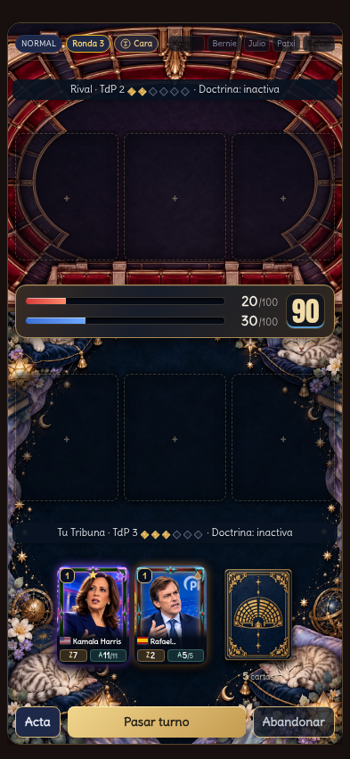
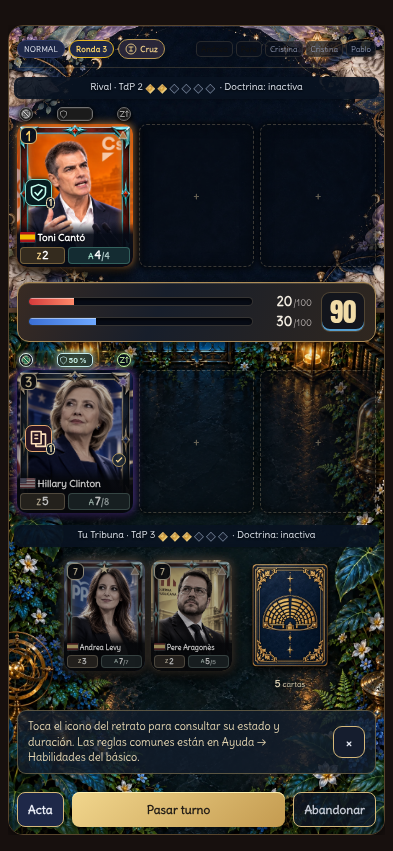

# Encuadre proporcional y material promocional · 1 de noviembre de 2026

Se mantiene v31.0.2.11. Caché `hemiciclo-v31.0.2.11-mat12`, 227 recursos. No requiere SQL ni cambia reglas, inventario, economía o progresión.

Cada mitad del combate mide su espacio real y elige entre la ilustración horizontal original (3:2) y una composición vertical (3:4) de su propio tema. Un zoom uniforme centrado llena el área completa; no se estiran las esquinas ni los laterales. El encuadre puede recortar parte del borde según la pantalla. La variante más próxima al espacio reduce ese recorte. Los seis temas tienen ambas composiciones, con procedencia y hashes en [mat-portrait-variants.json](../../design/mat-portrait-variants.json).

Jugador y rival conservan selecciones independientes. El fondo rival sigue girado 180°. Un `ResizeObserver` actualiza la variante al cambiar de orientación sin reconstruir el combate. Mano y Tribuna añaden sombras exteriores cortas de 3–4 píxeles; los iconos de estado, TdP y brillos de rareza mantienen su lectura y opacidad.

## Verificación

- 48 escenarios: seis temas, cuatro tamaños (320 × 568, 393 × 851, 768 × 1024 y 844 × 390), texto al 100 % y 116 % e iconos al 116 %. Cada rival utiliza un tema distinto al jugador.
- Cambio de orientación en los seis temas: mismo nodo de combate y selección de imagen acorde al nuevo espacio.
- Comprobación de centrado, relleno, proporción, sombras exteriores, estados opacos e interactivos, coste y cristales de TdP y bloqueo de jugadas con mesa llena. [Resultados](indicators.json).
- 25 pruebas unitarias de selección de variantes, respaldos, perfil y presentación de resultados. [Registro](tests.log).
- Actualización PWA desde `59a1fc4`: 227 recursos, seis variantes verticales decodificadas sin conexión y conservación de progreso, preferencias y motores históricos. [Resultado](pwa/pwa.json).

## Capturas y README

Siete capturas reales del juego a 393 × 851, escala 2, con progreso local de demostración. Se renuevan las siete piezas promocionales españolas de 1080 × 1920, vistas reducidas, portada, hoja resumen y dos imágenes de perfil/editor. El combate muestra Gatitos frente a Clásico. No se usan cuentas reales ni se sube material a una tienda.

El ZIP contiene las siete piezas, instrucciones y manifiesto; se verificaron dimensiones, RGB sin transparencia, hashes e integridad del archivo. El README actualiza personalización, tipografías, guardado y consejo pospartida. Sus diez imágenes y enlaces locales se validaron; la vista previa local de Markdown no presenta desbordamiento horizontal en móvil ni escritorio. Los resultados y scripts reproducibles se conservan en [marketing](../../marketing/README.md).
