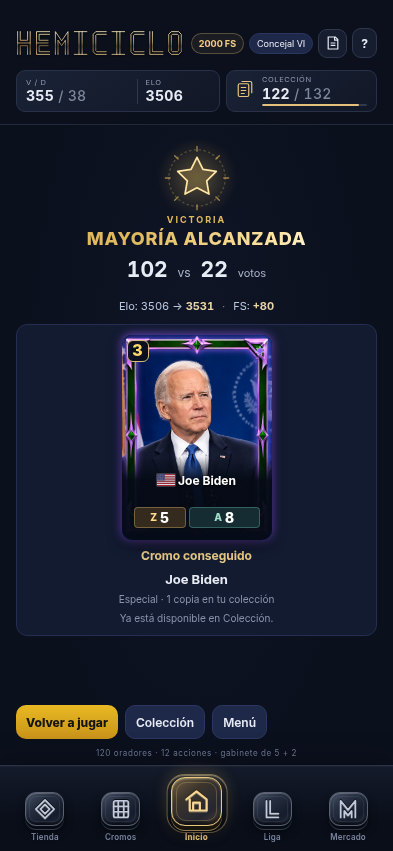
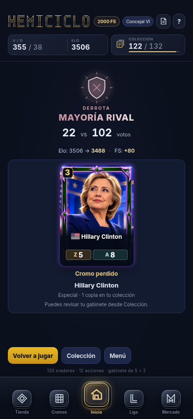
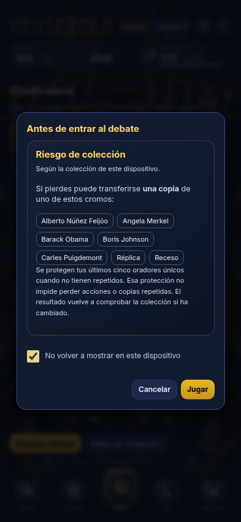
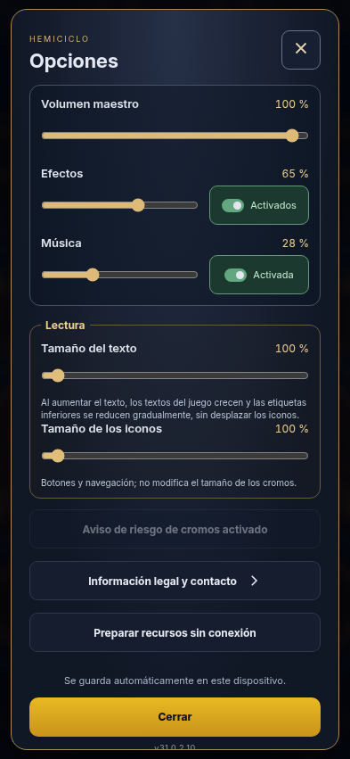

# v31.0.2.10 · Correcciones visuales menores

Cambios solicitados por Dooms: poder ocultar y recuperar el aviso de riesgo y aligerar el resultado del combate. Publicación en la misma versión, en `main`, `codex/online-actions-foundation` y `codex/claridad-v10`. La etiqueta original permanece intacta. Sin otra migración SQL.

## Comportamiento

El aviso comienza activado. La casilla solo guarda la elección al confirmar Jugar; Cancelar o cerrar no la aplica. La preferencia pertenece al dispositivo y se guarda separada del progreso, de la cuenta y del ajuste de texto. Un botón en Opciones la reactiva. Ocultar la ventana solo evita el preaviso informativo: preparación y liquidación mantienen sus validaciones de colección y premios.

El resultado muestra «votos propios vs votos rivales», con prioridad para los votos confirmados por el recibo. Victoria, derrota y empate tienen emblema y título propios; solo estos dos elementos se animan. Los votos y la línea Elo/FS no se animan ni desaparecen. Se retira el mensaje repetido del panel verde y se conservan el cromo transferido, sus protecciones, los recibos sin desglose, la condición de amistosa y las notas de temporada. El resumen no escribe premios.

## Verificación

- **1.986 pruebas pasan**, sin fallos ni omitidas: [tests.log](tests.log). Incluye recibos online y descargados, cero Elo, premios de Liga, elección persistente del aviso y cifras del resultado.
- **24 combinaciones visuales**: victoria, derrota y empate a 320×568, 393×851, 768×1024 y 844×390, con texto al 100 y 116 %. Controles sin cubrir y sin desbordamiento horizontal. Casilla operable con teclado y modal desplazable en pantalla corta. [browser.json](browser.json).
- Cancelar conserva el aviso; confirmar lo oculta, continúa la entrada y conserva el inventario. Persiste tras recargar; Opciones lo reactiva en Clasificatoria y Liga. Verificados título/emblema animados, votos y FS estáticos y movimiento reducido.
- Actualización PWA desde `e13f3e7`, caché anterior `hemiciclo-v31.0.2.10` → `hemiciclo-v31.0.2.10-results1`: **167 recursos**, progreso, Liga y aceptación conservados, uso sin conexión y motor histórico diferido disponibles. [pwa/pwa.json](pwa/pwa.json), [pwa.log](pwa.log).
- Compilación reproducible de offline8 (`--check`), sintaxis y `git diff --check` correctos. No cambian catálogo, habilidades, estadísticas, reglas, Elo ni premios.

Reproducción: `_dev/checks/results-minor-v10.cjs` usa el servidor local de `/workspace` en 8055 y Chromium; `_dev/checks/results-minor-v10-pwa.cjs` abre su propio servidor. Dependencias disponibles con `NODE_PATH=/workspace/.hemicycle-tools/node_modules`.

## Capturas

