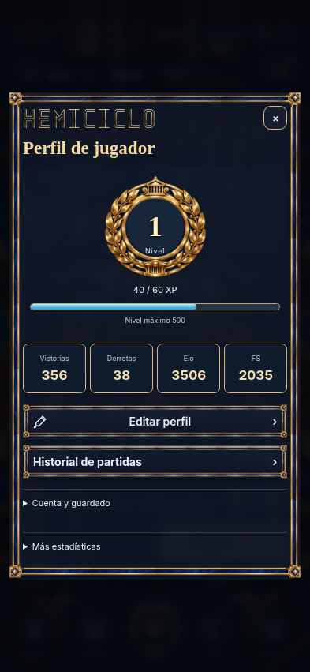
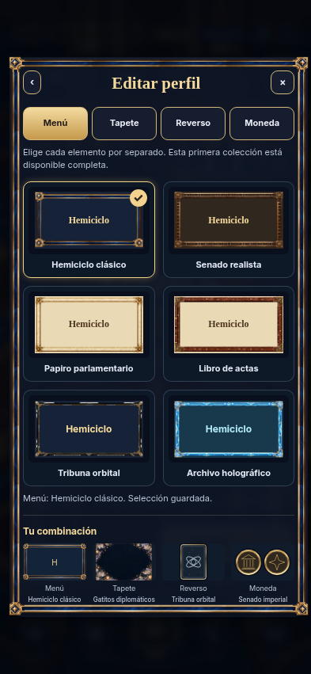
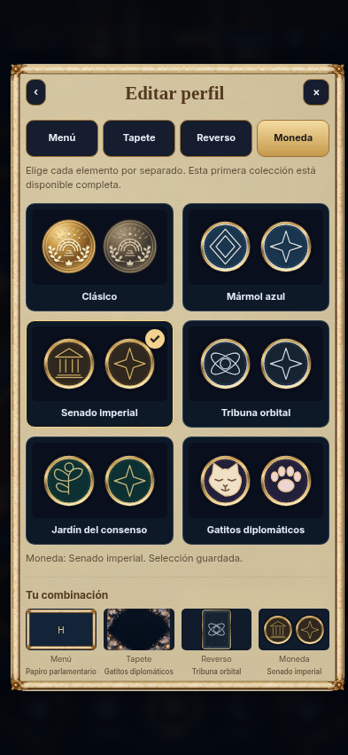
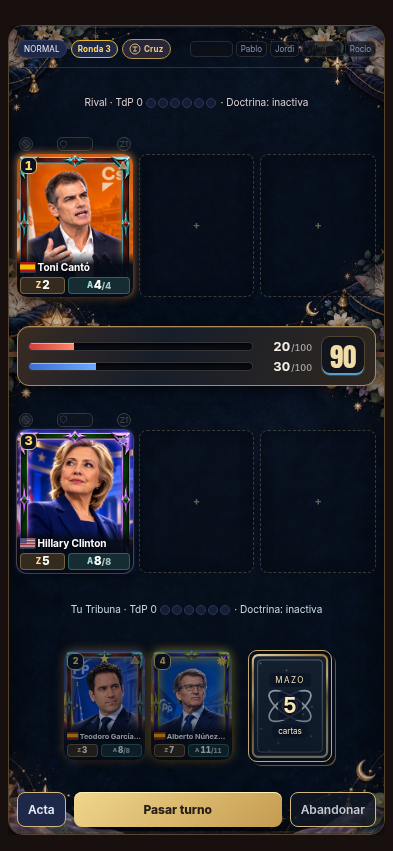
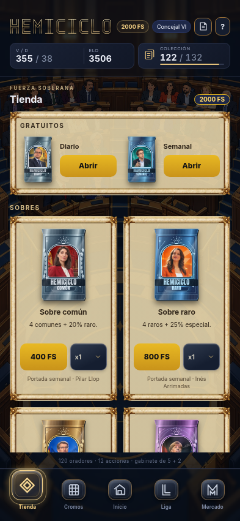

# Perfil, colecciones visuales y XP · v31.0.2.11

Implementación del diseño solicitado por Dooms y de su referencia de perfil limpio. La galería permite mezclar cuatro categorías, con los seis marcos iniciales y seis familias de combate disponibles. Las etapas nuevas de victorias llegan a 100.000 sin retirar los cobros anteriores. La nueva experiencia pertenece a su propia curva, independiente de Elo.

## Verificación

- **1.998 pruebas generales pasan**, sin fallos ni omitidas: [tests.log](tests.log).
- **46 comprobaciones finales** sobre perfil, respaldos, XP, objetivos, tutoriales, moneda y notas de versión: [final-ui-tests.log](final-ui-tests.log).
- PostgreSQL aislado: migración repetida, cobro online único, conflictos de revisión, tope de XP, permisos exclusivos del servicio, guardado de las cuatro elecciones, rechazo de XP manipulada y conservación con clientes anteriores: [sql-tests.log](sql-tests.log). La prueba descargada verifica además un recibo offline7 y otro offline8, con XP confirmada una sola vez.
- **48 diseños de editor**: seis menús × cuatro tamaños (320×568, 393×851, 768×1024 y 844×390) × texto al 100 y 116 %. Cuatro categorías y seis opciones, selección independiente, recarga y seis tapetes reales. **60 vistas adicionales** de Tienda, Colección, Liga, Ayuda y Novedades entre seis menús y dos tamaños. Sin desbordamiento horizontal ni errores de página o de carga de cosméticos: [browser/browser.json](browser/browser.json), [browser.log](browser.log).
- Los seis marcos y el emblema tienen centro transparente. Seis pares de monedas conservan la clase de animación y la moneda clásica conserva su dibujo: [assets.json](assets.json), [assets.log](assets.log).
- Actualización PWA desde `c8487e2`: **206 recursos** preparados, caché anterior sustituida, progreso y Liga conservados, aceptación intacta, funcionamiento sin conexión y motor histórico diferido. Se elige libro + gatos + reverso orbital + moneda imperial sin conexión y se conserva al recargar: [pwa/pwa.json](pwa/pwa.json), [pwa.log](pwa.log).
- `node _dev/build-offline.cjs --check`, sintaxis de scripts y `git diff --check` correctos. Los ocho motores browser/servidor y los datos de combate permanecen sin modificaciones.

La comprobación general cubre el nuevo sistema de XP y la compatibilidad de la economía. La última pasada visual complementa los ajustes finales de composición, materiales, etiquetas y guía del perfil. No se ha accedido ni escrito en datos de producción.

## Arte y presentación

Marcos y tapetes nuevos y emblema de nivel generados mediante la herramienta de imágenes, sin fotografías de personas ni recursos externos. Los originales se conservan en el directorio de imágenes generadas del entorno; se convierten a WebP para su uso como recursos del juego. Los reversos y caras nuevas de moneda se producen con `_dev/build-cosmetics.cjs`. El dibujo de la moneda clásica se conserva en `js/coin-toss.js`.

El marco se aplica con nueve zonas, esquinas de tamaño fijo y bordes repetibles. El fondo usa su propia opacidad. Se conserva el brillo de selección y se mantienen los colores de los tapetes ilustrados. Las estadísticas y las reglas utilizan la fuente de lectura del juego.

## Capturas reales

## Activación

Dooms confirmó «Success» tras ejecutar y guardar el SQL de [XP y cosméticos](../../online/20261031_profile_xp_cosmetics.sql) en Supabase. La publicación comprende `main`, `codex/online-actions-foundation` y la etiqueta v31.0.2.11, conservando `codex/perfil-xp-v11` para revisión. No se comprueba el despliegue de Pages. Los permisos administrativos de producción no están disponibles en este entorno.
