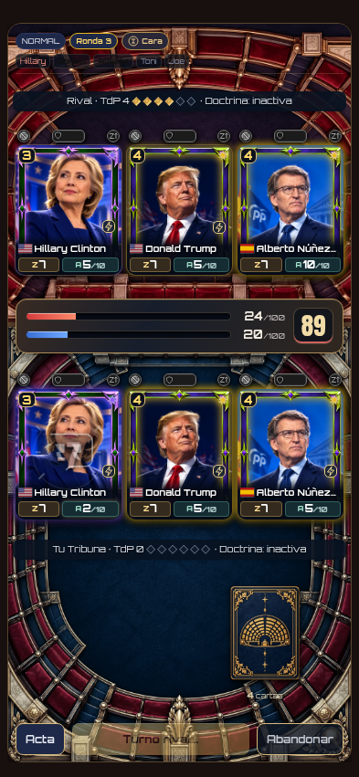
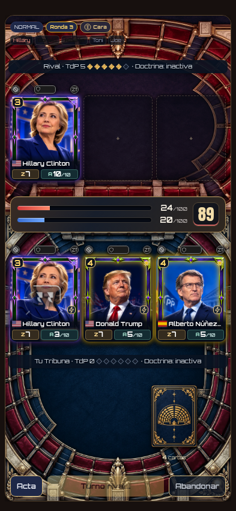

# Corrección de v31.0.2.12 · Cromos y ritmo de los zascas

Se mantiene v31.0.2.12. Revisión de recursos `31.0.2.12-zasca1`, caché `hemiciclo-v31.0.2.12-zasca1`, 227 recursos. Sin SQL ni cambios de reglas, relojes, premios o inventarios.

## Fallo reproducido

La prueba original del selector y las frases partía de oradores ya presentes. Faltaba la entrada y acción de un orador nuevo en una respuesta del rival.

La nueva prueba falló sobre la implementación anterior: el cromo era descendiente de una `.slot`, con ancho del retrato de **0 px** y sus iconos todavía visibles. El código también podía elegir un cromo existente como si fuese una casilla vacía, porque buscaba únicamente descendientes con `data-buid` y no examinaba el propio elemento.

La inserción ahora selecciona solo casillas vacías o cromos cuya retirada ha terminado y reemplaza el elemento completo. Cada orador queda como hijo directo de la Tribuna. La cuadrícula mantiene tres columnas del mismo ancho y se resincronizan las ilustraciones animadas al restaurar la mesa.

## Tiempos e interacción

Se elimina la espera de 1,4 segundos del anuncio de turno. La pérdida/recuperación de Aguante dura 200 ms y una retirada añade 90 ms. El zasca normal termina en 540–630 ms; el fuerte, en 580–670 ms. La presentación de un nuevo cromo añade 100 ms antes de intervenir. Defensa y curación liberan los controles a los 100 y 300 ms; sus efectos decorativos no capturan clics ni prolongan el bloqueo.

La frase conserva fuente y colores. Su escala pasa de 1 a 1,2 en el punto medio y vuelve a 1 al llegar. El ancho disponible incluye esa ampliación. Los zascas muestran comillas, diálogo y ondas, sin el proyectil ni el corte anterior de los oradores. Las cartas de acción mantienen su presentación.

## Comprobaciones

- 16 combinaciones de entrada seguida de acción: cuatro pantallas (320 × 568, 393 × 851, 768 × 1024 y 844 × 390), dos perspectivas y mesa vacía/ocupada. Se comprueban retrato decodificado, dimensiones, ausencia de cromos anidados, valores intermedios de Aguante, cero antes de retirarse y liberación de controles en menos de 1,1 segundos.
- Un caso adicional con mesa llena, expulsión, cambio de turno, entrada de otro cromo y nuevo zasca en la misma respuesta.
- Escala de la frase medida al inicio, mitad y llegada, comprobando sus límites en pantalla. Presencia del nuevo efecto de diálogo y ausencia de estela/corte en el zasca.
- 48 configuraciones del selector en seis temas y 17 flujos locales/remotos/descargados, incluyendo respuestas encadenadas, finales y movimiento reducido. [Resultados](full/browser.json).
- 163 pruebas unitarias. [Registro](tests.log).
- Actualización PWA desde `1306de3`, preservando progreso, 227 recursos y carga sin conexión. Se comprueba que la caché contiene la inserción corregida y el efecto nuevo. [Resultado](pwa/pwa.json).

[Datos de las entradas y de la ampliación](browser.json). Herramientas: [reproducción y regresión](../../checks/zasca-v12.cjs), [flujos completos](../../checks/zasca-v12-full.cjs), [PWA](../../checks/zasca-v12-pwa.cjs).

Las comprobaciones usan perfiles locales de demostración y un motor real como fixture; las conexiones a servicios de jugadores están bloqueadas durante la prueba visual.
