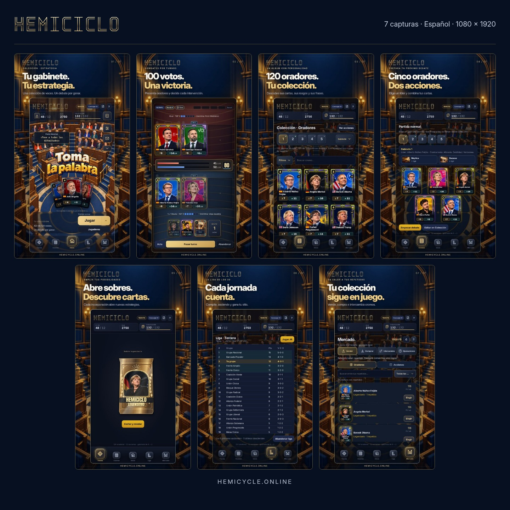

# Material promocional de Hemiciclo

Siete imágenes verticales en español, con edición épica sobria en azul noche, marfil y dorado. Las pantallas proceden del juego y mantienen su interfaz; el fondo y los titulares promocionales se componen alrededor.

**[Descargar las siete capturas en ZIP](https://github.com/DoomsGarden/Hemicycle/raw/refs/heads/main/press/hemiciclo-capturas-es.zip)** · [Ver el juego](https://hemicycle.online/) · [Volver a la presentación](../README.md)

| Imagen | Tema | Archivo completo |
| --- | --- | --- |
| 01 | Tu gabinete. Tu estrategia. | [Inicio](google-play/es-ES/01-inicio.png) |
| 02 | 100 votos. Una victoria. | [Combate](google-play/es-ES/02-combate.png) |
| 03 | 120 oradores. Tu colección. | [Colección](google-play/es-ES/03-coleccion.png) |
| 04 | Cinco oradores. Dos acciones. | [Gabinete](google-play/es-ES/04-gabinete.png) |
| 05 | Abre sobres. Descubre cartas. | [Sobres](google-play/es-ES/05-sobres.png) |
| 06 | Cada jornada cuenta. | [Liga](google-play/es-ES/06-liga.png) |
| 07 | Tu colección sigue en juego. | [Mercado](google-play/es-ES/07-mercado.png) |

Los siete originales promocionales son **PNG RGB de 24 bits, sin canal alfa, de 1080 × 1920 píxeles (9:16)**. El ZIP conserva su calidad. Las vistas pequeñas del README son JPEG optimizados y no deben sustituir a los originales al subir la ficha de una tienda.

Se han preparado con la interfaz de v31.0.2.6 y un progreso local de demostración. No contienen datos de cuentas reales ni pantallas legales. Las cifras de colección, saldo y clasificación representan ese estado de muestra; no prometen un inventario inicial ni una recompensa concreta. Las funciones de cuenta y Mercado entre jugadores requieren los requisitos indicados en el juego.

Para Google Play puedes usar los PNG en el apartado de capturas de teléfono. Comprueba los requisitos que muestre Play Console para tu ficha y dispositivo. Para publicaciones con otra proporción, conviene recomponer el diseño conservando las cartas y controles dentro del encuadre.

También tienes la [portada de presentación](../docs/media/readme-banner.jpg), las [capturas de interfaz sin la edición exterior](../docs/media/screenshots/) y el [manifiesto de dimensiones y archivos](capturas-es.json).

## Edición y regeneración

La composición editable está en [`_dev/marketing/promo.html`](../_dev/marketing/promo.html); los titulares, en [`slides.js`](../_dev/marketing/slides.js). El fondo deriva del hemiciclo original mediante generación de imagen; las interfaces se incorporan desde las capturas del juego y no se redibujan mediante IA.

Las herramientas de captura utilizan un navegador y datos de muestra aislados. No requieren acceso a cuentas de jugadores. Instrucciones de trabajo en [`_dev/marketing/README.md`](../_dev/marketing/README.md).
